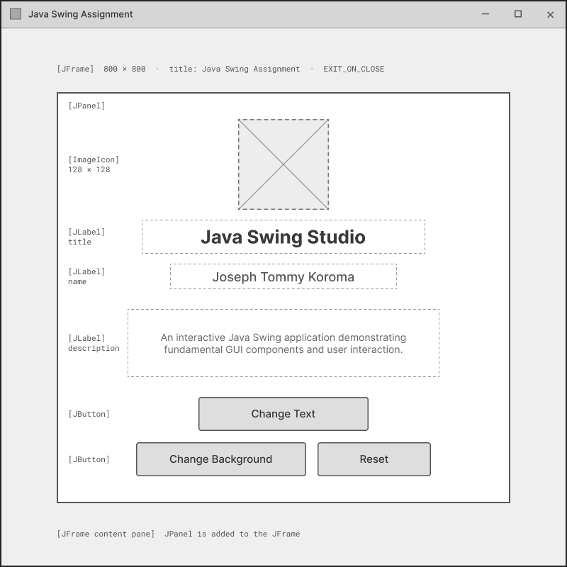
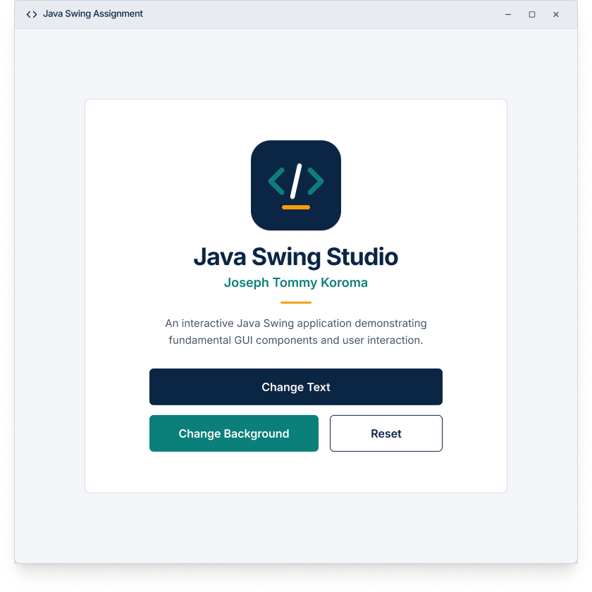

# Java Swing Assignment

**Student Name:** Joseph Tommy Koroma  
**Project Title:** Java Swing Assignment  
**Application Name:** Java Swing Studio  

## Project Overview
Java Swing Studio is a simple interactive Java desktop application developed to demonstrate the fundamental Java Swing components required by the assignment.

## Assignment Objectives
The primary objective of this project is to build an interactive GUI demonstrating understanding of core Java Swing components, object-oriented principles (inheritance and constructors), and basic event handling.

## Technologies Used
- Java
- Java Swing (javax.swing.*)
- Java AWT (java.awt.*)
- ImageIcon
- Git and GitHub

## Main Application Features
- **Interactive label text:** Changes the main greeting text when a button is clicked.
- **Changeable JPanel background:** Alters the background color of the main content panel.
- **Reset functionality:** Restores the application text and background color to their initial states.
- **Programming-themed application icon:** Custom window and UI graphics using `ImageIcon`.
- **Simple, centered desktop interface:** An 800x800 window designed accurately to the provided Figma mockups.

## Java Swing Components Used
- **JFrame**: The main application window. The `ClassAssignment` class inherits directly from `JFrame` (`public class ClassAssignment extends JFrame`). The window is configured to an 800x800 resolution and closes properly using `EXIT_ON_CLOSE`.
- **JPanel**: A container used to hold and organize the UI elements (`label`, buttons, description). The background color of this panel is interactive.
- **JLabel**: Used for displaying text. The main `label` variable displays the primary title ("Java Swing Studio") and is updated interactively. Additional labels display the student name and description.
- **ImageIcon**: Used to load the `app_logo.png` resource. It is applied to the application window frame (`setIconImage`) and embedded into the UI using a `JLabel` (`setIcon`).

## Project Structure
```text
JavaSwingAssignment/
├── src/
│   └── ClassAssignment.java
├── resources/
│   └── app_logo.png
├── wireframes/
│   ├── low_fidelity_wireframe.png
│   └── high_fidelity_wireframe.png
├── .gitignore
└── README.md
```

## Installation Prerequisites
- Java Development Kit (JDK) 8 or higher installed and configured in the system PATH.

## Compilation Instructions
To compile the application, navigate to the root directory of the project in your terminal and run:
```bash
javac src/ClassAssignment.java
```

## Execution Instructions
To execute the application, ensure the `resources` directory is available relative to where you run the program. From the root directory:
```bash
java -cp src ClassAssignment
```
*Note: The application expects the `app_logo.png` file to be located in the `resources/` folder relative to the execution directory.*

## Application Functionality
- **Change Text Button**: Modifies the main title label to say "Welcome to Java Swing!".
- **Change Background Button**: Changes the main panel's background to a light teal color.
- **Reset Button**: Restores the title label to "Java Swing Studio" and the background to white.

## Wireframe Images

### Low-Fidelity Wireframe


### High-Fidelity Wireframe


## Testing Information
- **Successful manual code inspection:** The source code was thoroughly reviewed and verified against all assignment requirements (inheritance, variables, components).
- **Tests not performed:** Successful compilation, successful application launch, and manual button testing could not be performed because the current environment does not have the `javac` compiler installed or a graphical interface available to launch desktop applications. Screenshots are consequently pending.

## Known Limitations
- Screenshots of the running application are currently missing as GUI execution was not performed in this environment.

## Conclusion
This submission successfully implements the necessary logic, layout, and OOP principles outlined in the Java Swing Assignment rubric. Upon adding the missing image asset and compiling in a local Java environment, the application will fully represent the high-fidelity design.
